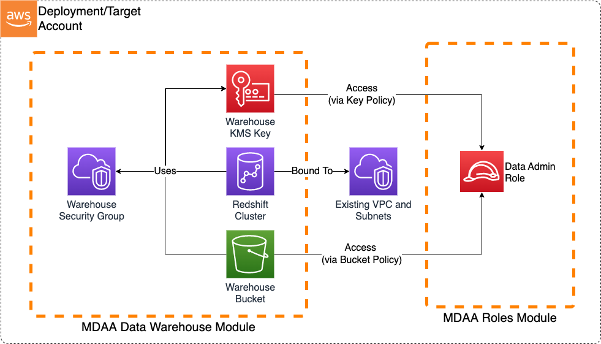

# Basic Data Warehouse

This is a sample basic Redshift Data Warehouse architecture which can be implemented using MDAA.



***

## Deployment Instructions

1. Edit the `mdaa.yaml` to specify an organization name. This must be a globally unique name, as it is used in the naming of all deployed resources, some of which are globally named (such as S3 buckets).

2. If required, edit the `mdaa.yaml` to specify `context:` values specific to your environment.

3. Ensure you are authenticated to your target AWS account and have CDK bootstrapped in your target region.

4. Deploy the architecture:
   ```bash
   npx @aws-mdaa/cli deploy
   ```

***

## Configurations

The sample configurations for this architecture are provided below.

### Config Directory Structure

```bash
basic_datawarehouse
│   mdaa.yaml
│   tags.yaml
│   roles.yaml
└───datawarehouse
    └───redshift.yaml
```

***

### mdaa.yaml

This [configuration](mdaa.yaml) specifies the global, domain, env, and module configurations required to configure and deploy this sample architecture.

*Note* - Before deployment, populate the mdaa.yaml with appropriate organization and context values for your environment

***

### tags.yaml

This [configuration](tags.yaml) specifies the tags to be applied to all deployed resources.

***

### roles.yaml

This [configuration](roles.yaml) will be used by the MDAA roles module to deploy a data admin role. This data admin role will be granted access to the warehouse bucket and KMS key, in order to
facilitate administrative activities.


***

### datawarehouse/datawarehouse.yaml

This [configuration](datawarehouse/datawarehouse.yaml) will be used by the MDAA Data Warehouse module to deploy a Redshift cluster.
